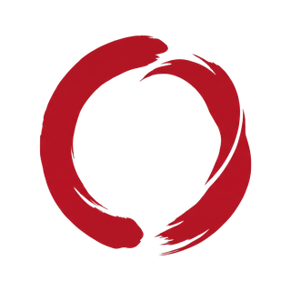

<p align="center">
  
</p>

<h1 align="center">genjutsu</h1>

<p align="center"><em>The art of illusion.</em><br />
Claude Code skills that make an interface move, give a product its look, and build a whole website.</p>

<p align="center">
  <a href="https://genjutsu.athevon.dev"><strong>Website</strong></a>
  &nbsp;·&nbsp;
  <a href="#examples"><strong>Examples</strong></a>
  &nbsp;·&nbsp;
  <a href="https://genjutsu.athevon.dev/docs"><strong>Documentation</strong></a>
  &nbsp;·&nbsp;
  <a href="https://genjutsu.athevon.dev/docs/install"><strong>Install</strong></a>
  &nbsp;·&nbsp;
  <a href="https://github.com/AThevon/genjutsu/discussions"><strong>Discussions</strong></a>
</p>

<p align="center">
  <a href="https://github.com/AThevon/genjutsu/releases/latest"></a>
  <a href="./LICENSE"></a>
  
  <a href="https://github.com/sponsors/AThevon"></a>
</p>

<p align="center">
  
  <br />
  <sub>genjutsu.athevon.dev, built with genjutsu: the lens on the 幻, then one cut each for cast (a demo drawn for the page), paint and bunshin.</sub>
</p>

Creative coding skills for [Claude Code](https://claude.ai/code), also packaged for [claude.ai](https://claude.ai) and [Cowork](https://claude.com/product/cowork). They cover Web (React, Vue, Svelte, Astro, vanilla CSS, Three.js, Canvas), Android (Jetpack Compose, Compose Multiplatform) and Apple (SwiftUI, iOS and macOS); `bunshin` is web only for now.

genjutsu is developed and run on Claude Code with Claude models, and what is and is not tested is written down. The claude.ai bundle was last checked by hand on 2026-09-28, `cast` only ([log](./docs/claude-ai-testing.md#7-log)); no Cowork run is logged; `bunshin` has only been run on Claude Code; one SwiftUI case and no Android run are recorded; no other agent or model has been tested. Each release says what it measured and what it did not in the [CHANGELOG](./CHANGELOG.md).

## Install

```bash
npx skills add https://genjutsu.athevon.dev -g
```

Then describe the task in Claude Code, or type `/genjutsu`. To follow releases: `npx skills update -g`. Keep the `-g` on both.

Use the URL, not the repository: `npx skills add AThevon/genjutsu` installs the skills without their modules.

Or as a Claude Code plugin, inside a session, which gives you `/genjutsu:cast`, `/genjutsu:paint` and `/genjutsu:bunshin`:

```text
/plugin marketplace add AThevon/genjutsu
/plugin install genjutsu
```

Project scope, claude.ai, Cowork, other agents and what bunshin needs beside it: [genjutsu.athevon.dev/docs/install](https://genjutsu.athevon.dev/docs/install).

## Three scales

| | You type, for example (not a recorded run) | You get |
|---|---|---|
| **`cast`**<br />one interface moves | `/genjutsu:cast make the pricing cards feel physical on hover` | An interaction thesis you approve, then the code in the stack you already use, with a short audit of what it wrote. |
| **`paint`**<br />a product's whole look | `/genjutsu:paint build me a portfolio from scratch` | A brainstorm, a visual and an interaction thesis, a `MASTER.md` design system, the page and a full audit. On a project that already has a design, it asks first what to keep. |
| **`bunshin`**<br />a whole site, by a team of agents | `/genjutsu:bunshin redesign our architecture practice's whole site from the current one and our project PDFs` | It states its cost, then asks you twice: the tier, then the direction. An art director runs research, one builder per page, reviewers and fix rounds; you get the site and a report of what was verified and what was not. |

Not sure which one? Ask for the result you want and the right skill is picked. [The FAQ](https://genjutsu.athevon.dev/docs/faq) has the long answer.

## Examples

Three recorded runs, on two fictional clients and one real one, captured from the code each run left or, for the real client, from the live site. Each links its receipt: how it ran, what it checked, and what it left unverified or got wrong.

<!-- genjutsu:examples:start -->
### Nocturne: a planetarium's late program, from dusk to the real 22:00 sky (plain CSS)

<a href="https://github.com/AThevon/genjutsu-examples/blob/readme-2026-11-14/nocturne/receipt.md"></a>

Asked for a planetarium's landing page from an empty template and a star catalogue, the run drew 403 stars and Saturn as they stand over Lisbon at 22:00, lit brightest first as the page scrolls from dusk to night.

<sub>`paint` · conversation with an agent playing the client · `claude-opus-5-5` · first pass · $5.93 (plus $0.86 for the client agent) · 0 human edits · 2026-10-04. Defect: from 1100 px wide the star list runs over the dome, as the end of the clip shows; two more are in the receipt. The run never saw its page.</sub><br />
[Receipt](https://github.com/AThevon/genjutsu-examples/blob/readme-2026-11-14/nocturne/receipt.md) · [Transcript](https://github.com/AThevon/genjutsu-examples/blob/readme-2026-11-14/nocturne/transcript.md) · [Live demo](https://genjutsu-examples.vercel.app/nocturne/)

### Chef Ovatio: a private chef's seven-page site in French and English (Astro)

<a href="https://github.com/AThevon/genjutsu-examples/blob/readme-2026-11-14/chef-ovatio/receipt.md"></a>

A real private chef's site, seven pages in French and English, made from his public Instagram profile and two answers; scrolling the home, the plate sets like a sun behind a cobalt horizon.

<sub>`bunshin` · the run `bunshin` was extracted from · `claude-opus-5-5` · about 10.5M subagent tokens · 1 human edit · 2026-09-29. The edit, made since: door titles that could not be read across their photos now stand on them. No verdict read the last round of fixes. Filmed from the live site.</sub><br />
[Receipt](https://github.com/AThevon/genjutsu-examples/blob/readme-2026-11-14/chef-ovatio/receipt.md) · [Live demo](https://chef-ovatio.vercel.app)

### Folio: the "Mark as paid" action (Motion)

<a href="https://github.com/AThevon/genjutsu-examples/blob/readme-2026-11-14/invoice-mark-paid/receipt.md"></a>

On a fixture invoice page, asked to make a dead "Mark as paid" action feel like the money landed, the run made the amount leave Outstanding and land in Paid as both totals count, in one headless pass.

<sub>`cast` · one-shot headless run · `claude-opus-5-5` · first pass · $1.88 · 0 human edits · 2026-10-04. Defect its own audit missed: on a shorter window the page scrolls while the totals count. The pointer is drawn in by the recorder, not by the build.</sub><br />
[Receipt](https://github.com/AThevon/genjutsu-examples/blob/readme-2026-11-14/invoice-mark-paid/receipt.md) · [Live demo](https://genjutsu-examples.vercel.app/invoice-mark-paid/)

These are three of the nine recorded runs. The other six, among them the three that came out plain or thin and [the first SwiftUI run](https://github.com/AThevon/genjutsu-examples/blob/readme-2026-11-14/etale-ios/receipt.md), keep their receipts in [genjutsu-examples](https://github.com/AThevon/genjutsu-examples/tree/readme-2026-11-14) at the tag `readme-2026-11-14`; the gallery is at [genjutsu.athevon.dev/examples](https://genjutsu.athevon.dev/examples).
<!-- genjutsu:examples:end -->

## It shows you before it writes

`cast` and `paint` stop at a few gates (the interaction thesis, the visual identity, the design system) and ask once how you want to see the proposal: a rendered page with the easing curve plotted and a replay button, a throwaway preview route in your own project, or one sentence in the conversation. It is a proposal either way: a preview route is deleted once you approve, and none of it becomes the implementation.

## It names the slop, and measures itself

genjutsu keeps a catalogue of the defaults a model reaches for when nobody asked (the numbered eyebrow, three equal cards, an invented `ESTD. 2018`), and one command lists them in any project, each with its `file:line`: [the tells field guide](https://genjutsu.athevon.dev/docs/tells).

Every run shown above is recorded with what it cost and what it got wrong or left unverified. The measurements, with their limits, are in the [CHANGELOG entry for v4.2.0](./CHANGELOG.md#v420---2026-11-13) and in [baseline-2026-11](https://github.com/AThevon/genjutsu-examples/tree/main/baseline-2026-11). They are small, one brief or one case with two to six runs each, and their graders and judges are ours or a model: read them as genjutsu measured against what it set out to do, not as an independent benchmark. The with and without eval table dates from 2026-09-28 (v4.0.0) and has not been rerun since: [the last published result](./evals/README.md#the-last-published-result).

## Docs

[Overview](https://genjutsu.athevon.dev/docs) · [Install](https://genjutsu.athevon.dev/docs/install) · [`cast`](https://genjutsu.athevon.dev/docs/cast) · [`paint`](https://genjutsu.athevon.dev/docs/paint) · [`bunshin`](https://genjutsu.athevon.dev/docs/bunshin) · [Modules](https://genjutsu.athevon.dev/docs/jutsu) · [Tells](https://genjutsu.athevon.dev/docs/tells) · [Principles](https://genjutsu.athevon.dev/docs/principles) · [FAQ](https://genjutsu.athevon.dev/docs/faq) · [Changelog](./CHANGELOG.md)

Formerly `creative-excellence` (v2.x): the migration steps are in [CHANGELOG.md, v3.0.0](./CHANGELOG.md#v300---2026-04-26). Not Higgsfield Genjutsu, the video tool: genjutsu here is a set of skills for interface motion and design in coding agents.

## Tell us how it came out

One minute, two answers: [how did it come out?](https://github.com/AThevon/genjutsu/issues/new?template=1-output.yml) Output that came out wrong is as useful as output that came out well. A finished run ends its report with the same link, filled in with the skill, the version, the host and the model, and with nothing from your project.

With more to show, post the run in [Show and tell](https://github.com/AThevon/genjutsu/discussions/categories/show-and-tell). Questions go to [Q&A](https://github.com/AThevon/genjutsu/discussions/categories/q-a), ideas to [Ideas](https://github.com/AThevon/genjutsu/discussions/categories/ideas), bugs with a repro to [issues](https://github.com/AThevon/genjutsu/issues/new/choose).

## Contributing

The most valuable contribution is "this claim is wrong, here is the primary source". Start with [CONTRIBUTING.md](./CONTRIBUTING.md); the rows marked `VERIFY-NEEDED` in [`skills/_jutsu/VERSIONS.md`](./skills/_jutsu/VERSIONS.md) are the open work.

## Credits

- [nextlevelbuilder/ui-ux-pro-max-skill](https://github.com/nextlevelbuilder/ui-ux-pro-max-skill) (MIT): the `ui-ux-pro-max` module vendors its design dataset and Python search engine ([UPSTREAM.md](./skills/_jutsu/ui-ux-pro-max/UPSTREAM.md)).
- [Impeccable](https://impeccable.style) ([pbakaus/impeccable](https://github.com/pbakaus/impeccable), Apache 2.0): not vendored. When it is installed, bunshin hands it the direction, the quality floor and the finish review, among other steps.
- [Leonxlnx/taste-skill](https://github.com/Leonxlnx/taste-skill) (MIT): the idea of writing down the defaults a model reaches for comes from there. The tells catalogue is rewritten as detection, and `scripts/check-no-verbatim.sh` checks that no passage was copied.

<details>
<summary>Everything else genjutsu learned from (29 sources)</summary>

**Web foundation**

- [mxyhi/ok-skills](https://github.com/mxyhi/ok-skills) - granular GSAP decomposition, "Do Not" patterns, interaction thesis concept
- [freshtechbro/claudedesignskills](https://github.com/freshtechbro/claudedesignskills) - BAD/GOOD pitfall patterns, reference file separation
- [kylezantos/design-motion-principles](https://github.com/kylezantos/design-motion-principles) - designer perspectives (Emil Kowalski, Jakub Krehel, Jhey Tompkins), Motion Gap Analysis
- [anthropics/claude-plugins-official](https://github.com/anthropics/claude-plugins-official) - `frontend-design` plugin, anti-AI-slop philosophy

**Android / Compose**

- [aldefy/compose-skill](https://github.com/aldefy/compose-skill) - granular Compose docs with androidx source receipts
- [Meet-Miyani/compose-skill](https://github.com/Meet-Miyani/compose-skill) - Compose / CMP / KMP comprehensive
- [new-silvermoon/awesome-android-agent-skills](https://github.com/new-silvermoon/awesome-android-agent-skills) - Android architecture skills
- [skydoves/Orbital](https://github.com/skydoves/Orbital) - shared element transitions, Compose Multiplatform
- [fornewid/material-motion-compose](https://github.com/fornewid/material-motion-compose) - Material Motion patterns, Compose and CMP
- [drinkthestars/shady](https://github.com/drinkthestars/shady) - AGSL shaders rendered in Compose
- [Mortd3kay/liquid-glass-android](https://github.com/Mortd3kay/liquid-glass-android) - glassmorphism with AGSL in Compose
- [JumpingKeyCaps/DynamicVisualEffectsAGSL](https://github.com/JumpingKeyCaps/DynamicVisualEffectsAGSL) - AGSL playground
- [mutualmobile/compose-animation-examples](https://github.com/mutualmobile/compose-animation-examples) - Compose animation collection

**Apple / SwiftUI**

- [twostraws/SwiftUI-Agent-Skill](https://github.com/twostraws/SwiftUI-Agent-Skill) - SwiftUI best practices reference
- [twostraws/swift-agent-skills](https://github.com/twostraws/swift-agent-skills) - curated directory of Swift agent skills
- [twostraws/Inferno](https://github.com/twostraws/Inferno) - Metal shaders for SwiftUI (the reference)
- [Treata11/iShader](https://github.com/Treata11/iShader) - Metal fragment shaders for SwiftUI
- [jamesrochabrun/ShaderKit](https://github.com/jamesrochabrun/ShaderKit) - composable Metal shaders and holographic UI
- [raphaelsalaja/metallurgy](https://github.com/raphaelsalaja/metallurgy) - SwiftUI Metal shaders library
- [eleev/swiftui-new-metal-shaders](https://github.com/eleev/swiftui-new-metal-shaders) - SwiftUI 5 Metal shader collection
- [AvdLee/SwiftUI-Agent-Skill](https://github.com/AvdLee/SwiftUI-Agent-Skill) - SwiftUI animations, transitions, PhaseAnimator
- [dpearson2699/swift-ios-skills](https://github.com/dpearson2699/swift-ios-skills) - 83 Swift skills (swiftui-animation, gestures, liquid-glass among them)
- [rshankras/claude-code-apple-skills](https://github.com/rshankras/claude-code-apple-skills) - Apple platform skills
- [GetStream/swiftui-spring-animations](https://github.com/GetStream/swiftui-spring-animations) - complete guide to SwiftUI springs
- [amosgyamfi/open-swiftui-animations](https://github.com/amosgyamfi/open-swiftui-animations) - SwiftUI animations collection
- [Shubham0812/SwiftUI-Animations](https://github.com/Shubham0812/SwiftUI-Animations) - 20+ custom SwiftUI animations and Metal

**UX and motion theory**

- Steven Hoober, "Designing for Touch" (thumb zones research)
- [Material Design 3 Motion](https://m3.material.io/styles/motion/overview/specs) and [M3 Expressive](https://m3.material.io/blog/m3-expressive-motion-theming)
- [Apple HIG iOS](https://developer.apple.com/design/human-interface-guidelines/) and [macOS](https://developer.apple.com/design/human-interface-guidelines/macos)

</details>

## Support

genjutsu is free and MIT. If it saved you a few rounds of generic output, you can [sponsor its development on GitHub](https://github.com/sponsors/AThevon).

## License

[MIT](LICENSE)

---

<p align="center">
  Built by <a href="https://athevon.dev"><strong>Adrien Thevon</strong></a>, software engineer in Toulouse.
  <br />
  <sub>
    Also mine:
    <a href="https://github.com/AThevon/TokenEater">TokenEater</a>, a native macOS monitor for Claude usage limits
    &nbsp;·&nbsp;
    <a href="https://github.com/AThevon/worktigre">worktigre</a>, a git worktree manager
  </sub>
</p>
